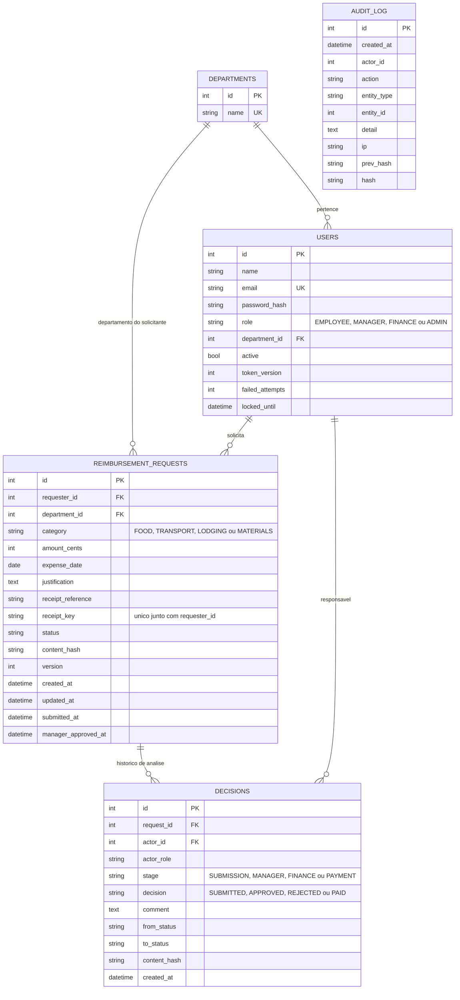

# NexusCorp – Plataforma de Gestão de Reembolsos · Documentação técnica

API REST em **Python (FastAPI + SQLAlchemy)** com banco relacional (SQLite por padrão; PostgreSQL via `DATABASE_URL`).
Documentação interativa gerada a partir dos contratos: `http://localhost:8000/docs` (Swagger) e `/redoc`.

## 1. Descrição da solução

A API centraliza o ciclo de vida de uma solicitação de reembolso, do rascunho ao pagamento, substituindo planilhas e e-mails.

* **Identificação**: login por e-mail/senha devolve um JWT (30 min). Todas as rotas, exceto `/auth/login` e `/health`, exigem token válido.
* **Autorização por perfil e por registro**: o que cada usuário *vê* é definido na própria consulta ao banco (`app/policy.py`); o que ele *faz* depende de perfil, situação da solicitação e autoria.
* **Fluxo** (`RASCUNHO → AGUARDANDO GESTOR → AGUARDANDO FINANCEIRO → APROVADA → PAGA`, ou `RECUSADA` nas duas etapas de análise):

| Situação (valor na API) | Próxima ação permitida |
|---|---|
| Rascunho (`DRAFT`) | Dono edita, exclui ou envia |
| Aguardando gestor (`PENDING_MANAGER`) | Gestor do departamento aprova ou recusa |
| Aguardando financeiro (`PENDING_FINANCE`) | Financeiro aprova ou recusa |
| Aprovada (`APPROVED`) | Financeiro registra o pagamento |
| Paga (`PAID`) / Recusada (`REJECTED`) | Encerrada: não pode ser alterada nem excluída |

* **Rastreabilidade**: cada envio, aprovação, recusa e pagamento grava um registro imutável em `decisions` (quem, perfil, etapa, decisão, observação, data, hash do conteúdo analisado). Há ainda uma trilha técnica `audit_log` encadeada por hash (logins, acessos negados, leituras de terceiros, alterações de cadastro).
* **Estrutura do código**: `routers/` (HTTP e contratos) → `services.py` (fluxo e regras) → `policy.py` (quem vê/faz o quê) → `models.py` (esquema + guardas de integridade) → `audit.py`, `security.py`.

### Decisões de escopo
* O enunciado define três perfis de negócio. Criei um quarto perfil **técnico**, `ADMIN`, só para cadastrar usuários/departamentos, alterar perfil/vínculo e consultar a auditoria. Ele **não** acessa solicitações. Sem ele não haveria caminho seguro para RN15 (alteração de perfil só fora das "operações comuns").
* Uma solicitação representa **uma despesa** (categoria, valor, data, justificativa, comprovante), conforme a seção 3 do enunciado.
* O departamento da solicitação é gravado na criação, a partir do cadastro do solicitante (nunca vem do cliente).

## 2. Modelo de dados



Pontos de modelagem
* **Valores em centavos inteiros** (sem erro de ponto flutuante); a API recebe/devolve decimal com 2 casas.
* **RN05 no banco**: `UNIQUE (requester_id, receipt_key)`, onde `receipt_key` é a referência normalizada (sem espaços extras, maiúscula). A API também verifica antes e responde 409 limpo.
* `decisions` e `audit_log` **não têm UPDATE/DELETE** (bloqueados no ORM); `audit_log` não tem FK de propósito, para sobreviver à exclusão de rascunhos.
* `version` (bloqueio otimista) impede que duas decisões simultâneas se sobreponham.

## 3. Contrato das principais operações

Autenticação: `Authorization: Bearer <token>`. Erros seguem `{"detail": "..."}` (422 traz a lista de campos inválidos).

| Operação | Método e rota | Entrada | Saída (sucesso) |
|---|---|---|---|
| Login | `POST /auth/login` (form `username`=e-mail, `password`) | – | `200 {access_token, token_type}` |
| Logout (invalida tokens) | `POST /auth/logout` | – | `204` |
| Meu cadastro | `GET /me` · `PATCH /me {name?, current_password?, new_password?}` | – | `200 UserOut` |
| Departamentos | `GET /departments` | – | `200 [{id,name}]` |
| Criar solicitação | `POST /reimbursements` | `{category, amount, expense_date, justification, receipt_reference}` | `201 RequestOut` (situação `DRAFT`) |
| Listar | `GET /reimbursements?department_id&status&category&mine&limit&offset` | – | `200 [RequestSummary]` |
| Detalhar | `GET /reimbursements/{id}` | – | `200 RequestOut` |
| Editar rascunho | `PUT /reimbursements/{id}` | mesmo corpo da criação | `200 RequestOut` |
| Excluir rascunho | `DELETE /reimbursements/{id}` | – | `204` |
| Enviar ao gestor | `POST /reimbursements/{id}/submit` | – | `200` (`PENDING_MANAGER`) |
| Aprovar (gestor ou financeiro, conforme a etapa) | `POST /reimbursements/{id}/approve` | `{comment?}` | `200` (`PENDING_FINANCE` ou `APPROVED`) |
| Recusar | `POST /reimbursements/{id}/reject` | `{justification}` **obrigatória** | `200` (`REJECTED`) |
| Registrar pagamento | `POST /reimbursements/{id}/pay` | `{payment_reference}` | `200` (`PAID`) |
| Histórico de análise | `GET /reimbursements/{id}/history` | – | `200 [{actor, actor_role, stage, decision, comment, from_status, to_status, content_hash, created_at}]` |
| Cadastro (ADMIN) | `POST /admin/users`, `GET /admin/users`, `PATCH /admin/users/{id}`, `POST /admin/departments` | ver Swagger | `201/200` |
| Auditoria (ADMIN) | `GET /audit?action&entity_type&entity_id`, `GET /audit/verify` | – | `200` |

Exemplo de criação:
```json
POST /reimbursements
{"category":"FOOD","amount":"180.00","expense_date":"2026-11-10","justification":"Almoço com cliente","receipt_reference":"NF-1001"}
→ 201 {"id":1,"status":"DRAFT","amount":"180.00","requester":{"id":4,"name":"Ana Colaboradora"},
       "department":{"id":1,"name":"Comercial"},"allowed_actions":["edit","delete","submit"], ...}
```
`allowed_actions` informa o que *aquele* usuário pode fazer agora na solicitação. O corpo de criação/edição **só aceita os 5 campos** acima: `requester_id`, `department_id`, `status` etc. geram 422.

**Códigos HTTP (diferenciação exigida na seção 8)**

| Código | Significado | Exemplos |
|---|---|---|
| 401 | Falha de identificação | sem token, token inválido/expirado/revogado, senha errada |
| 403 | Falta de permissão | ler solicitação alheia, gestor de outro departamento, financeiro antes da hora, autoaprovação, elevação de perfil |
| 404 | Recurso inexistente | identificador que não existe |
| 409 | Violação de regra de negócio | comprovante duplicado, editar/excluir após envio, pagar antes da aprovação, conteúdo divergente do enviado |
| 422 | Dados inválidos | valor ≤ 0, data futura, categoria desconhecida, recusa sem justificativa, campos extras |
| 429 | Conta bloqueada por tentativas de login |

## 4. Matriz de permissões

| Operação | Anônimo | Colaborador | Gestor | Financeiro | Admin |
|---|:-:|:-:|:-:|:-:|:-:|
| Login | ✔ | ✔ | ✔ | ✔ | ✔ |
| Ver/alterar nome e senha próprios; logout | ✘ | ✔ | ✔ | ✔ | ✔ |
| Alterar perfil/departamento (próprio ou de outros) | ✘ | ✘ | ✘ | ✘ | só de **outros** |
| Criar solicitação | ✘ | ✔ | ✔ | ✔ | ✘ |
| Editar / excluir / enviar | ✘ | só as próprias, em rascunho | só as próprias, em rascunho | só as próprias, em rascunho | ✘ |
| Listar e detalhar | ✘ | só as próprias | próprias + **enviadas** do seu departamento | próprias + as já **encaminhadas pelo gestor** | ✘ |
| Aprovar/recusar etapa 1 (aguardando gestor) | ✘ | ✘ | seu departamento, nunca a própria | ✘ | ✘ |
| Aprovar/recusar etapa 2 (aguardando financeiro) | ✘ | ✘ | ✘ | sim, nunca a própria | ✘ |
| Registrar pagamento | ✘ | ✘ | ✘ | sim, nunca a própria | ✘ |
| Histórico de uma solicitação | ✘ | das próprias | das que enxerga | das que enxerga | ✘ |
| Cadastrar usuários e departamentos | ✘ | ✘ | ✘ | ✘ | ✔ |
| Consultar auditoria | ✘ | ✘ | ✘ | ✘ | ✔ |

Rascunhos de terceiros nunca são visíveis, para ninguém.

## 5. Regras de negócio implementadas

| Regra | Onde é aplicada | Teste |
|---|---|---|
| RN01 Identificação | `security.current_user` em toda rota restrita | `test_rn01_requires_authentication` |
| RN02 Confidencialidade | `policy.visibility_clause` na consulta SQL; `load_visible` em toda rota por id; resposta 403 sem dados | `test_cenario_01…`, `test_rn02_…` |
| RN03 Responsabilidade departamental | `policy.decision_stage` (departamento do gestor = departamento da solicitação) + visibilidade | `test_cenario_02…`, `test_rn03_…`, `test_cenario_07…` |
| RN04 Valor > 0 | `schemas.RequestIn.amount` (`gt=0`, 2 casas, teto R$ 50.000) | `test_rn04_rn06_and_input_validation` |
| RN05 Duplicidade | `services._check_receipt` + `UNIQUE(requester_id, receipt_key)` + handler de `IntegrityError` | `test_rn05_…` |
| RN06 Data futura | `schemas.RequestIn.not_future` | `test_rn04_rn06_and_input_validation` |
| RN07 Alteração só em rascunho | `services._owned_draft` + guarda ORM `before_update` | `test_rn07_…`, `test_cenario_06…` |
| RN08 Só vai ao financeiro após o gestor | máquina de estados (`ALLOWED_TRANSITIONS`) + financeiro só vê o que tem `manager_approved_at` | `test_cenario_05…`, `test_finance_sees_only_…` |
| RN09 Sem autoaprovação | `policy.decision_stage` e `policy.can_pay` (`requester_id != user.id`) | `test_rn09_no_self_approval` |
| RN10 Pagamento só após aprovação financeira | `services.pay` (409 se não estiver `APPROVED`) | `test_full_flow_and_closed_states` |
| RN11 Recusa com justificativa | `RejectIn.justification` obrigatória + checagem no serviço; gravada em `decisions` | `test_rn11_…` |
| RN12 Rastreabilidade | `decisions` (append-only) + `audit_log` encadeado | `test_cenario_08…`, `test_orm_blocks_history_rewrite` |
| RN13 Credenciais | hash PBKDF2 com salt por usuário; `UserOut` sem hash; login com resposta uniforme | `test_rn13_…`, `test_cenario_03…` |
| RN14 Sessão | JWT expira; `token_version` revoga em logout, troca de senha ou mudança de perfil/departamento; usuário desativado é barrado a cada requisição | `test_rn14_…` |
| RN15 Proteção dos perfis | `PATCH /me` só altera nome/senha (campos de perfil → 403 + auditoria); corpo das solicitações não aceita campos extras; alteração real só por `PATCH /admin/users/{id}` (ADMIN, auditado) | `test_cenario_04…`, `test_rn15_…` |
| Fluxo §6 e estados encerrados | `ALLOWED_TRANSITIONS` + guardas | `test_full_flow_and_closed_states`, `test_finance_rejection_closes_process` |
| Filtros por departamento/situação/categoria | `GET /reimbursements` (filtros só restringem, nunca ampliam) | `test_filters_by_department_status_and_category` |

## 6. Decisões de segurança

1. **Autorização na consulta, não só na rota.** A cláusula de visibilidade vai no `WHERE` de toda leitura; um filtro como `?department_id=` não amplia o acesso (Cenário 07).
2. **Identidade vem do token, nunca do corpo.** Solicitante, departamento e situação são definidos pelo servidor; o esquema rejeita campos desconhecidos (`extra="forbid"`).
3. **403 em vez de 404 para o que existe mas é alheio.** A seção 8 exige distinguir falta de permissão de inexistência. A resposta não traz nenhum dado do registro. O custo é permitir confirmar que um identificador existe; se a empresa preferir, trocar o 403 por 404 em `load_visible` (uma linha). Tentativas ficam registradas como `ACCESS_DENIED`.
4. **Credenciais.** PBKDF2-HMAC-SHA256 (310 mil iterações, salt individual, comparação em tempo constante). Login devolve a mesma resposta para e-mail inexistente e senha errada, com hash fictício para equalizar o tempo. Bloqueio por 15 min após 5 falhas. Segredo do JWT vem de `NEXUS_JWT_SECRET` (sem ele, a aplicação usa um segredo efêmero e avisa).
5. **Sessões revogáveis.** Cada token carrega a `token_version` do usuário; logout, troca de senha e mudança de perfil/departamento a incrementam. Usuário inativo é barrado em toda requisição.
6. **Imutabilidade em três camadas:** regra de serviço (409), guardas do ORM (campos protegidos, transições, exclusão só de rascunho) e **hash do conteúdo** gravado no envio e conferido em cada aprovação/pagamento. Se alguém alterar a linha direto no banco, a próxima decisão é barrada (`INTEGRITY_VIOLATION`, Cenário 06).
7. **Operações atômicas.** Mudança de estado, histórico e auditoria são gravados na mesma transação; operação negada faz rollback e só a tentativa fica na auditoria. Bloqueio otimista contra decisões concorrentes.
8. **Auditoria à prova de adulteração.** `audit_log` é encadeado por hash; `GET /audit/verify` recalcula a cadeia e acusa qualquer edição ou remoção.
9. **Menor privilégio e minimização.** ADMIN não vê reembolsos; listagens devolvem resumo (sem justificativa nem comprovante); leituras de terceiros são registradas; o ORM usa consultas parametrizadas (sem SQL montado por texto).
10. **Erros sem vazamento.** Mensagens não expõem hash, token nem detalhes internos.

### Limitações conhecidas da v1
* Se um departamento só tem um gestor e ele mesmo pede reembolso, a solicitação fica sem quem a analise (RN09). Cadastrar um segundo gestor resolve.
* Auditoria usa lock de processo; com várias instâncias, usar lock do PostgreSQL (`pg_advisory_xact_lock`).
* Tabelas criadas no startup (`create_all`); para produção, usar migrations (Alembic). Falta também rate limiting no gateway e HTTPS (responsabilidade da infraestrutura).
